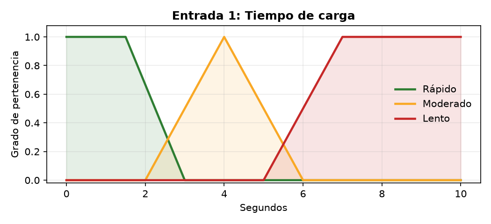
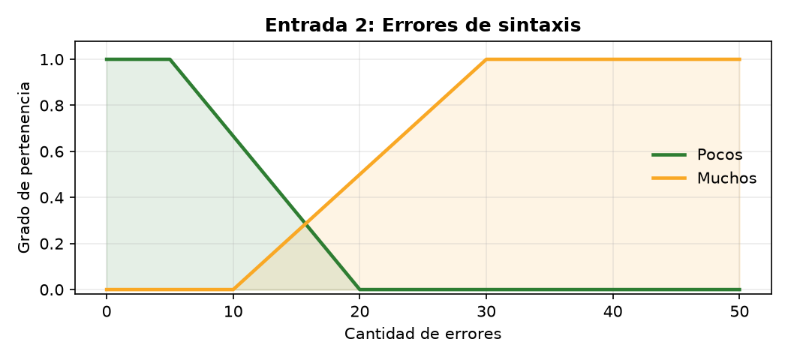
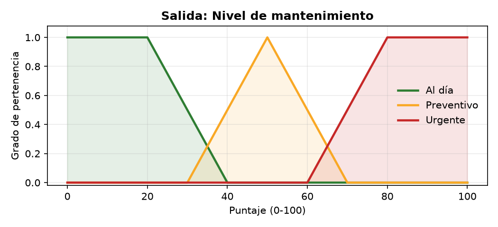
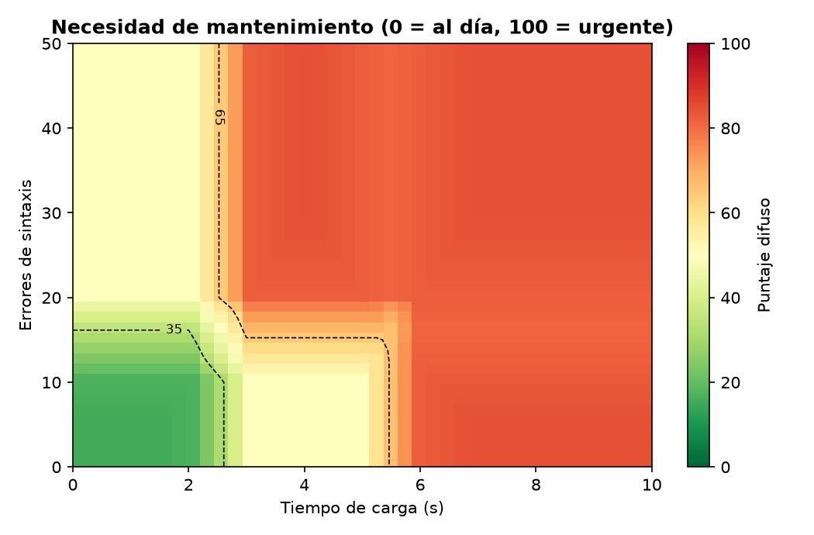

# Fase 2: Lógica difusa (20%)

Motor de inferencia **Mamdani** con scikit-fuzzy ([motor.py](motor.py)). Convierte datos técnicos
en un veredicto que entiende cualquier persona.

| Variable | Universo | Conjuntos |
|---|---|---|
| Entrada 1: `tiempo_carga` | 0 a 10 s | Rápido, Moderado, Lento |
| Entrada 2: `errores_sintaxis` | 0 a 50 | Pocos, Muchos |
| Salida: `mantenimiento` | 0 a 100 puntos | Al día, Preventivo, Urgente |

## Funciones de pertenencia

| Conjunto | Tipo | Parámetros | Justificación |
|---|---|---|---|
| Rápido | trapecio | 0, 0, 1.5, 3 | Google considera bueno responder en menos de 2-3 s |
| Moderado | triángulo | 2, 4, 6 | Zona límite de tolerancia del usuario |
| Lento | trapecio | 5, 7, 10, 10 | Más de 5-6 s: la mayoría abandona la página |
| Pocos | trapecio | 0, 0, 5, 20 | Unos pocos avisos del validador W3C son normales |
| Muchos | trapecio | 10, 30, 50, 50 | Decenas de errores indican HTML descuidado |
| Al día | trapecio | 0, 0, 20, 40 | |
| Preventivo | triángulo | 30, 50, 70 | |
| Urgente | trapecio | 60, 80, 100, 100 | |

Los conjuntos se traslapan a propósito: así 2,9 s y 3,1 s no dan veredictos opuestos.





## Base de reglas

Cubre las 3 × 2 = 6 combinaciones, así que ningún sitio queda sin veredicto.

| # | Tiempo | Errores | Mantenimiento | Por qué |
|---|---|---|---|---|
| R1 | Rápido | Pocos | **Al día** | Rápido y con código limpio |
| R2 | Rápido | Muchos | **Preventivo** | Carga bien, pero los errores pueden romper la página |
| R3 | Moderado | Pocos | **Preventivo** | Código bien, velocidad en el límite |
| R4 | Moderado | Muchos | **Urgente** | Los dos problemas se suman |
| R5 | Lento | Pocos | **Urgente** | Una página lenta pierde a la mayoría de visitantes |
| R6 | Lento | Muchos | **Urgente** | Regla del enunciado |

Operador Y = mínimo, agregación = máximo, defuzzificación = centroide.
El **nivel** final es el conjunto de salida con mayor pertenencia en el puntaje obtenido.



## Diferencias con el código base del enunciado

El fragmento de ejemplo de la guía tenía la regla `velocidad['lento'] → mantenimiento['bajo']`
y devolvía "Urgente" cuando el resultado era **menor** que 5. Esa combinación funciona por
casualidad pero contradice la lógica. Aquí la escala va en un solo sentido
(más puntaje = más urgente) y las reglas dicen lo que significan.

## Integración con la ontología

El nivel difuso (`Al día`, `Preventivo`, `Urgente`) existe como individuo en la ontología
(`mw:NivelMantenimiento`) y se traduce al estado del sitio con `ontologia.consultas.interpretar_nivel()`:
Urgente → Crítico, Preventivo → Aceptable, Al día → Excelente.

## Uso

```python
from fuzzy.motor import evaluar, describir
r = evaluar(tiempo_carga=4.2, errores_sintaxis=12)
r["nivel"]             # 'Preventivo'
r["puntaje"]           # 55.7
r["reglas_activadas"]  # reglas disparadas con su fuerza y justificación (para el Dashboard)
describir(r)           # 'Tiempo de carga 4.2 s = Moderado (90%); 12 errores = Pocos (53%). ...'
```

```bash
python -m fuzzy.motor              # tabla de casos de ejemplo
python -m fuzzy.graficas           # regenera las imágenes de docs/img/
python -m unittest discover tests  # pruebas
```

## Nota sobre el centroide

Entre 5 y 6 s con muchos errores, el puntaje baja unos 3 puntos (de 84 a 81) antes de volver
a subir. Pasa porque dos reglas Urgente (R4 y R6) se activan a medias y el área recortada
desplaza el centroide. El nivel sigue siendo Urgente, y una prueba automática vigila que
esta oscilación nunca supere 5 puntos ni cambie el nivel.
